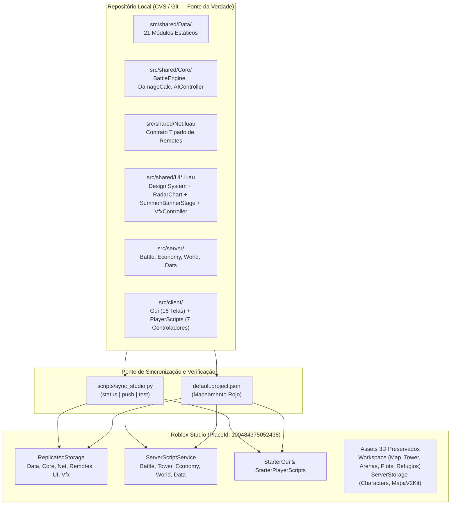

# Guia de Arquitetura, Estruturação de Código e Protocolo para Agentes — RobloxProjetoX

> **Propósito:** Definir a arquitetura oficial do **RobloxProjetoX**, documentar a organização modular implementada em `src/` (sincronizada 1:1 com o Roblox Studio) e estabelecer o **Protocolo Operacional Obrigatório** para como Agentes de IA (e subagentes de código, UI, VFX, 3D e mapa) devem trabalhar em cima desta arquitetura sem introduzir regressões.

---

## 1. Visão Geral da Arquitetura Implementada

O projeto adota a arquitetura profissional **Disk-First + 4 Camadas (Data / Core / Server Services / Client Views)**, unindo a velocidade de edição/versionamento local (`src/`) com a execução em tempo real no **Roblox Studio** via MCP e **Rojo** (`default.project.json`).



---

## 2. Mapa Completo da Árvore de Código (`src/` ↔ Roblox Studio)

Todos os **118 scripts ativos** do projeto estão extraídos, modularizados e sincronizados na pasta `src/`:

### 2.1. `src/shared/` → `ReplicatedStorage`
| Caminho em `src/shared/` | Instância no Studio | Papel Arquitetural |
| :--- | :--- | :--- |
| **`Core/BattleEngine.luau`** | `ReplicatedStorage.Core.BattleEngine` | **Máquina de estados pura do combate 1x1 / 2x2 / 6x6**. Resolve turnos, prioridade (Fuga > Troca/Item > Velocidade), PP (`OncePerBattle`), Expansão de Domínio (`MalevolentShrine` 2 rodadas, 15% sangramento e moveset exclusivo `Fuga`), precisão, status e captura sem depender de `Players` ou `Workspace`. |
| **`Core/RaidEngine.luau`** | `ReplicatedStorage.Core.RaidEngine` | **Máquina de estados pura da Raid Global Cooperativa 4×1**. Resolve turnos de 1–4 jogadores + Aliados NPCs, 2 vidas individuais com revive automático em 2 turnos, Escudo de Fase (`65%`/`30%` HP), Pulso de Anulação, 2 ações/turno do Boss e ranking de dano/MVP sem depender de `Players` ou `Workspace`. |
| **`Core/DamageCalc.luau`** | `ReplicatedStorage.Core.DamageCalc` | **Fórmula matemática oficial do GDD (Seção 5)**, multiplicadores de estágios (`-6` a `+6`), spread `0,75x` em 2x2, regras de status e cálculo de dano esperado (`ExpectedDamage`). |
| **`Core/AIController.luau`** | `ReplicatedStorage.Core.AIController` | **IA de Batalha** (`Facil`, `Medio` 70%/30%, `Dificil` com análise de matchup, Expansão de Domínio e uso de status, em `1x1` e `2x2`). |
| **`Net.luau`** | `ReplicatedStorage.Net` | **Contrato único de rede** com tipos exportados (`RemoteEventName` e `RemoteFunctionName`) documentando os Remotes do jogo. |
| **`Data/*.luau` (24 arquivos)** | `ReplicatedStorage.Data.*` | Tabelas de configuração puras: `Characters`, `Moves`, `Passives`, `Awakening`, `Raids`, `TypeChart`, `Items`, `Progression`, `AccountLevel`, `StarterTrack`, `PvPRank`, `Gyms`, `Genetics`, `Training`, `Tower`, `Summon`, `SummonStageThemes`, `Encounters`, `Base`, `Refuge`, `ProductIds`, `Benefits`, `Retention`, `Audio`. |
| **`UI.luau`, `UIKit.luau`, `UITheme.luau`, `TeamCards.luau`, `RadarChart.luau`, `SummonBannerStage.luau`** | `ReplicatedStorage.*` | **Design System Midnight-Blue Anime & Palco 3D**: construção programática de telas em escala (`Scale`), paleta azul-noturno, brilho diagonal `UI.sheen` (38°), botões com afundamento 3D, 100% ícones personalizados (`UI.Icons`), cards 3D, gráfico de radar e palco 3D ao vivo de invocação. |
| **`CombatAnimator.luau`, `VfxController.luau`, `VariantController.luau`** | `ReplicatedStorage.*` | Animações procedurais 60 FPS em `Motor6D`, execução de efeitos visuais em 3 fases (`Charge`, `Release`, `Impact`) e aplicação visual de variantes (`Brilhante`, `Ouro`, `Rubi`, etc.). |
| **`HollowPurple/*.luau` (7 arquivos)** | `ReplicatedStorage.HollowPurple.*` | Sistema modular AAA do *Vazio Roxo* (`Config`, `Janitor`, `LightningModule`, `DebrisModule`, `CameraEffects`, `LightingEffects`, `HollowPurpleVFX`). |
| **`Sukuna/*.luau` (8 arquivos)** | `ReplicatedStorage.Sukuna.*` | Sistema modular AAA de *Ryomen Sukuna* (`Config`, `Janitor`, `CinematicCamera`, `SoundManager`, `AnimatorModule`, `MalevolentShrineEnv`, `FugaVFX`, `SukunaVFX`) — câmera cinematográfica em `RenderStepped`, legendas sincronizadas, Santuário Malevolente 3D e Rework AAA de 6 fases (`0.00s..8.80s`) da Chama Divina (*Fuga*). |

### 2.2. `src/server/` → `ServerScriptService`
| Subpasta / Módulo | Instância no Studio | Responsabilidade no Servidor |
| :--- | :--- | :--- |
| **`Battle/BattleService.luau`** | `ServerScriptService.Battle.BattleService` | Gerencia as sessões de batalha dos jogadores (`sessions[player]`), valida ações recebidas via `SubmitAction`, orquestra PvP (`1x1` e `2x2`) com timer de 30s e entrega recompensas via hooks. |
| **`Battle/ArenaManager.luau`** | `ServerScriptService.Battle.ArenaManager` | Alocação e limpeza das arenas físicas (`Workspace.Arenas`), posicionamento de modelos R15 no piso (`StandAt` 1x1/2x2), câmera espelhada de PvP e retorno à praça (`ReturnToPlaza`). |
| **`Battle/BattleConfig.luau`** | `ServerScriptService.Battle.BattleConfig` | Tempos de apresentação de cada evento (`EventDelay`), cooldown de gatilho e configuração padrão. |
| **`Battle/PvPService.luau`** | `ServerScriptService.Battle.PvPService` | Convites de desafio por proximidade na praça (`1x1` e `2x2`), nivelamento em nível 50, ranking ELO (`PvPRank`) e início de partida PvP. |
| **`Tower/TowerService.luau`** | `ServerScriptService.Tower.TowerService` | Progressão nos modos `Facil`, `Medio`, `Dificil` e `Infinito` (`1x1` e `2x2`), 5 Ginásios de Anime (`Gyms`: Naruto, One Piece, Bleach, Jujutsu Kaisen e Dragon Ball), Modo Treino (`Practice`), chefes a cada 5 andares e placares. |
| **`Economy/SummonService.luau`** | `ServerScriptService.Economy.SummonService` | Portais Comum (gold) e Premium (gemas), bloqueio de banners por Ginásio, raridade global **`Secreto`** (`0,001%` em qualquer banner para conta `Nv. 15+`), garantia (*pity* 200 e 60), bloqueio regional via `PolicyService`, fusão de estrelas e venda de repetidos. |
| **`Economy/BaseService.luau` & `TrainingService.luau`** | `ServerScriptService.Economy.*` | Terrenos (`Plots`), passeio (`Gold/s` ao vivo), mineração (gold + minério bruto + 4 minérios de atributo com nível 1..10) e Cúpula de Vidro (Treino de +20 em +20, cronômetro, upgrade e bloqueios). |
| **`Economy/InventoryService.luau`** | `ServerScriptService.Economy.InventoryService` | Compra e uso de itens (Poções, Cura-Status, Éter, Reviver, Selos) dentro e fora de batalha. |
| **`Economy/MonetizationService.luau`** | `ServerScriptService.Economy.MonetizationService` | `MarketplaceService.ProcessReceipt`, compra de Game Passes / Benefícios por Robux ou Gemas. |
| **`World/RefugeService.luau`, `RaidService.luau` & `EncounterService.luau`** | `ServerScriptService.World.*` | Refúgio privado da base (caverna, spawn de selvagens por nível da Forja 1..10, baú de drops), Evento Global de Raid Cooperativa 4×1 (relógio UTC, lobbies, 3 arenas dedicadas, MVP e captura pós-Raid) e encontros selvagens. |
| **`Data/*.luau` (9 arquivos)** | `ServerScriptService.Data.*` | `PlayerDataService` (DataStore com trava de sessão), `AccountLevelService` (XP e recompensas de nível da conta), `ProgressionService` (XP, nível, aprendizado de golpes), `TeamService`, `AlbumService`, `RetentionService` (login diário, baús de tempo, missões, trilha inicial), `SettingsService`, `Clock`, `DataMain`. |

### 2.3. `src/client/` → `StarterGui` & `StarterPlayerScripts`
* **`src/client/Gui/<NomeGui>/<NomeClient>.client.luau` (17 telas):**
  * `BattleClient`, `RaidClient`, `HudClient`, `SummonClient`, `EquipeClient`, `TeamBarClient`, `RefugeClient`, `RewardsClient`, `ShopClient`, `PvPClient`, `BaseUiClient`, `BagClient`, `TowerClient`, `SettingsClient`, `CharacterDetailClient`, `TrainingClient`, `LevelRewardsClient`.
* **`src/client/PlayerScripts/*.client.luau` (7 controladores):**
  * `MapFxClient`, `AudioClient`, `VipTagClient`, `BaseClient`, `NpcWalkClient`, `WildClient`, `CharacterAuraClient`.

---

## 3. Como os Agentes de IA Devem Trabalhar Nesta Arquitetura (Protocolo Obrigatório)

Para que múltiplos agentes (ou sessões futuras) trabalhem no projeto mantendo **zero conflito**, **código limpo** e **sincronia total com o Studio**, todo agente deve seguir os **6 Mandamentos Operacionais** abaixo:

### Mandamento 1: Fluxo "Edit on Disk → Push → Verify"
Nenhum agente deve alterar scripts diretamente no Roblox Studio deixando o disco desatualizado. O ciclo obrigatório para qualquer tarefa de código é:

```powershell
# 1. Verificar se o ambiente está sincronizado antes de começar
python scripts/sync_studio.py status

# 2. Editar os arquivos em src/ usando as ferramentas de arquivo (edit_file / write_file)

# 3. Enviar as alterações para o Roblox Studio aberto
python scripts/sync_studio.py push

# 4. Rodar a bateria de testes de integridade no Studio
python scripts/sync_studio.py test
```

### Mandamento 2: Respeitar os Limites de Tamanho e Coesão de Módulo
* **Limite máximo recomendado por arquivo:** **400 a 500 linhas**.
* **Proibido recriar "God Modules":**
  * Se um agente precisar adicionar uma nova regra de turno (ex: clima, habilidade passiva, novo efeito de golpe), ele deve editar **`src/shared/Core/BattleEngine.luau`** ou **`src/shared/Core/DamageCalc.luau`** — e **nunca** misturar código de cálculo dentro de `BattleService.luau` ou `ArenaManager.luau`.
  * Se um agente precisar alterar posicionamento de câmera de batalha, iluminação de arena ou posição dos rigs 3D, ele deve editar **`src/server/Battle/ArenaManager.luau`** — sem tocar em `BattleEngine.luau`.

### Mandamento 3: Isolamento Estrito entre as 4 Camadas (Regras de Dependência)
Os agentes devem respeitar a direção única de dependências (`Client / Server` → `Core` → `Data`):

1. **Módulos em `src/shared/Data/`** NÃO PODEM dar `require` em nada fora de `Data/`. Eles apenas retornam tabelas de configuração.
2. **Módulos em `src/shared/Core/`** SÓ PODEM dar `require` em outros módulos de `Core/` ou `Data/`. É **estritamente proibido** usar `Players`, `Workspace`, `ServerScriptService`, `RemoteEvent` ou `task.wait` dentro de `Core/`.
3. **Módulos em `src/client/`** NUNCA alteram estado de jogo por conta própria. Toda ação do jogador passa por um `RemoteEvent` / `RemoteFunction` documentado em `src/shared/Net.luau`, e a UI apenas reflete o estado retornado pelo servidor.
4. **Módulos em `src/server/`** NUNCA confiam nos parâmetros enviados pelo cliente. Todo handler de Remote deve validar:
   * Tipo primitivo (`typeof(x) == "string"`, inteiro válido, sem `NaN`).
   * Estado atual do jogador (ex: não permitir usar item fora de batalha ou iniciar outra ação enquanto `BattleService.IsInBattle(player)` for `true`).
   * Posse e saldo real no `PlayerDataService`.

### Mandamento 4: Receitas Padronizadas por Tipo de Tarefa (Playbooks para Agentes)

Quando o usuário pedir uma expansão do jogo, o agente deve seguir exatamente o roteiro correspondente:

#### Playbook A — Criar ou Editar um Personagem (`Agente de Dados + Blender/3D`)
1. **Regra de Originalidade (GDD Seção 4):** Proibido usar nomes ou visuais copiados de animes existentes. Seguir o padrão R15 blocky (5,5 studs, até 10.000 triângulos, textura 1024x1024).
2. **No Studio (`ServerStorage/Characters/<Id>`):** Garantir que o Model R15 possua `HumanoidRootPart`, `Humanoid` e a pasta `Animations` (`Idle`, `Walk`, `Attack`, `Hit`, `Faint`, `Victory`, `Mine`).
3. **No Disco (`src/shared/Data/Characters.luau`):** Adicionar os atributos base e a tabela `Learnset` (níveis `5, 10, 18, 26, 35, 45`).
4. **Nos Portais/Zonas (`src/shared/Data/Summon.luau` / `Encounters.luau` / `Refuge.luau`):** Registrar o ID do personagem na pool correspondente.
5. **Sincronizar e Testar:** Rodar `python scripts/sync_studio.py push` e `python scripts/sync_studio.py test`.

#### Playbook B — Criar um Novo Golpe e seu VFX (`Agente de Combate + VFX`)
1. **No Disco (`src/shared/Data/Moves.luau`):** Adicionar a definição do golpe (`Name`, `Type`, `Category`, `Power`, `Accuracy`, `PP`, `Effect`, `Anim`, `Vfx`, `Timing = { Charge, Release, Impact }`).
2. **Se o golpe tiver um novo tipo de `Effect`:** Implementar o tratamento na função `BattleEngine:_ApplyEffect` em [`src/shared/Core/BattleEngine.luau`](file:///c:/Users/vieir/Documents/antigravity/RobloxProjetoX/src/shared/Core/BattleEngine.luau) e testar de forma determinística com `Seed` fixa.
3. **No Studio (`ReplicatedStorage/Vfx/<MoveVfx>`):** Criar o modelo de efeito respeitando o orçamento do GDD Seção 11 (máx. 150 partículas, 200 em assinatura; 3 camadas: núcleo claro, cor do tipo, resíduos; `PointLight` sem sombra) e registrar/acionar via `src/shared/VfxController.luau`.

#### Playbook C — Criar ou Modificar uma Tela de UI (`Agente de UI`)
1. **Sempre usar o Design System (`src/shared/UI.luau` e `UITheme.luau`):**
   * Nunca criar janelas com tamanhos fixos em pixels (`Offset`). Usar sempre `Scale` + `UIAspectRatioConstraint`, deixando apenas `UIStroke` e sombras em pixels recalculados pela altura da tela.
   * Garantir área mínima de toque de `44x44 px` para compatibilidade mobile.
2. **Editar o controlador da tela em `src/client/Gui/<TelaGui>/<TelaClient>.client.luau`** e sincronizar com `python scripts/sync_studio.py push`.

#### Playbook D — Modificar o Mapa ou Modelos no Blender (`Agente de Mapa / 3D`)
1. **Preservação de Instâncias:** Nunca deletar pastas inteiras do `Workspace` sem backup. As arenas em `Workspace.Arenas` precisam manter obrigatoriamente as partes `PlayerPoint`, `EnemyPoint`, `CameraPoint` e `FloorMid` (exigidas pelo `ArenaManager.luau`).
2. **Execução no Blender:** Usar `D:\Blender\blender.exe --background --python <script.py>` para gerar/processar malhas e animações antes de importar para `ServerStorage/Imported` ou `ServerStorage/Characters`.

---

### Mandamento 5: Tratamento de Erros e Efeitos Cosméticos
* **Cosméticos nunca travam o turno:** Em `VfxController.luau`, `AudioClient.client.luau` e `ArenaManager.luau`, qualquer animação, som ou partícula deve ser chamada de forma segura (se uma animação ou textura não carregar a tempo, o fluxo lógico da batalha continua após o `delay` configurado em `BattleConfig.luau`).
* **Limpeza de Memória:** Todo efeito instanciado no `Workspace` deve ser agendado no `Debris:AddItem(inst, lifetime)` ou destruído explicitamente no `cleanup` da sessão.

### Mandamento 6: Verificação Automática antes de Concluir Qualquer Turno
Antes de dar uma tarefa como concluída para o usuário, o agente **DEVE** comprovar que:
1. `python scripts/sync_studio.py status` retorna `All scripts in src/ are 100% in sync with Roblox Studio.`
2. `python scripts/sync_studio.py test` retorna `PASS`.
3. Se uma mecânica nova foi adicionada em `Core/`, uma asserção correspondente foi adicionada em `cmd_test` dentro de [`scripts/sync_studio.py`](file:///c:/Users/vieir/Documents/antigravity/RobloxProjetoX/scripts/sync_studio.py).
